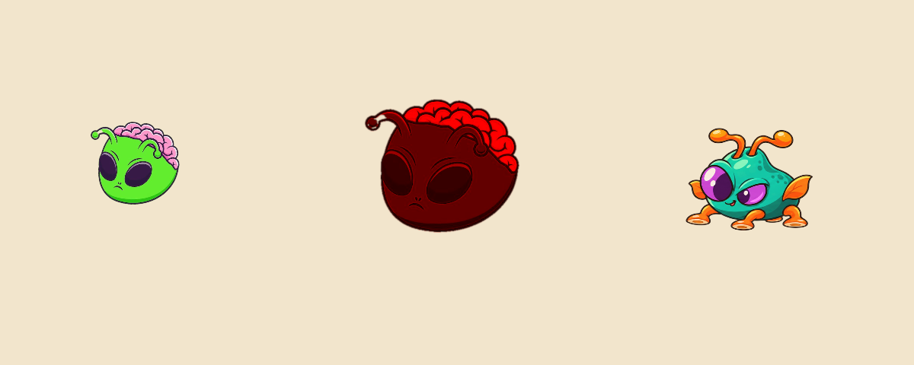
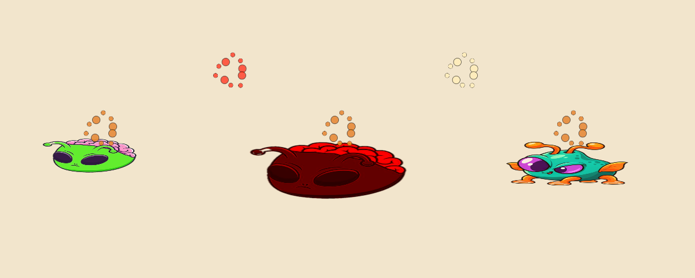

# Battlegrounds animation: first pass

Adds procedural motion to the existing artwork:

- Regular aliens bounce and sway with a quick gait; Brutes use a slower, heavier gait.
- Enemy, Brute, and Shooter squash around their feet when caught by pancakes, wobble briefly, and hold a flattened pose. A short syrup splash accompanies the reaction.
- Consumed tomatoes leave orange-red droplets; consumed pies leave cream droplets. Collisions with enemy shots use the same respective effect. Lifetime expiry does not create an impact.

`BattlegroundAlienMotion` attaches from each alien's existing Awake method. It creates a render-only child and hides the original renderer with forceRenderingOff. The source renderer still receives authored Animator sprite changes and existing status tints; the child copies both in LateUpdate. No prefab or scene wiring is required. Shooter's existing walk and shooting clips remain authoritative; procedural gait is applied only to Enemy and Brute.

Movement stays on the original root. Animated scale, tilt, and bob affect only the visual child. Pancake reactions do not introduce a recovery or change the existing immobilization behavior. Projectile lifetime, movement, damage, and collision settings are preserved; a consumption guard prevents repeated callbacks from spawning duplicate effects.

`BattlegroundFoodBurst` creates ten small outlined droplets using one shared runtime sprite. Effects last 0.42 scaled seconds and have no physics components. Both motion and effect lifetime use scaled time, following game pause, speed changes, and slowdown. No additional packages or generated artwork are required.

## Unity validation

Imported and compiled in the running Unity 6000.6.8f1 Editor. The final verification passed 24 runtime checks, with no errors or exceptions reported afterward. See [validation.txt](validation.txt).

[verify-editor.cs](verify-editor.cs) is a reusable Unity_RunCommand source, outside Assets so it does not ship in the game. Run it in Play mode. It creates prefab samples outside the board, confirms real frame advancement, checks gait and pause, sprite/tint forwarding, unchanged root scale, repeated pancake requests, flattened poses, effect cleanup, and component disable/re-enable. It restores the time/background settings and removes its samples. The preview camera renders directly from Unity; these are engine captures rather than artwork reconstructions.

The splashes above were triggered in isolation to show all three colors together. These checks do not constitute a full wave playthrough or a projectile collision integration test. Review visual overlap in crowded lanes, hitbox readability during squash, and impact timing during an actual Battlegrounds wave before release. The first pass reuses static artwork for procedural gait; it does not add individually drawn stepping poses, seeds, crust pieces, or syrup puddles.

## Remaining opportunities

Salad firing recoil, ice cream/frost activation, salsa/heat activation, damage and defeat reactions, and food placement/destruction remain for subsequent passes.
