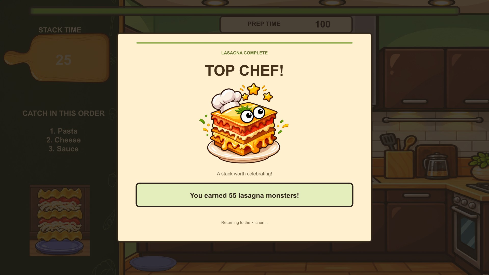
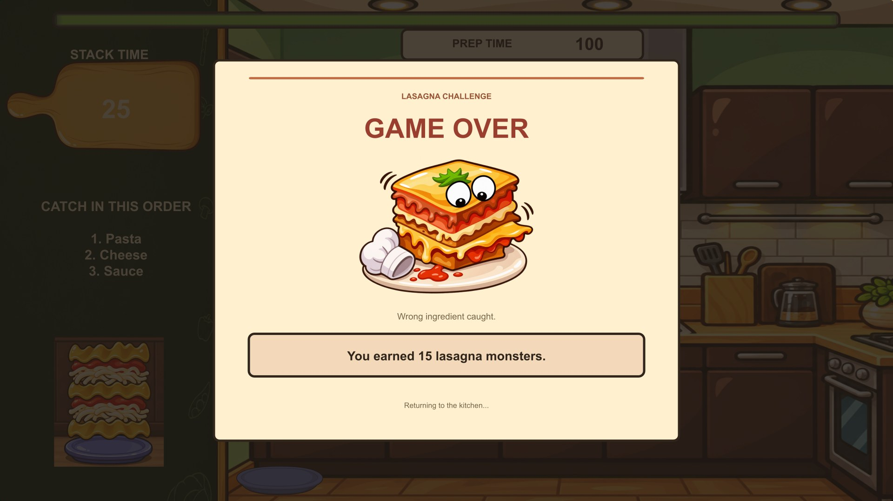

# Lasagna success and game-over screens

Both LasagnaMiniGame result overlays now use matching cream cartoon cards, crisp native headings, original lasagna character illustrations, live reward totals and a return-to-kitchen note. Top Chef has gold stars, a chef hat and green accents; game over has a slipped stack, a fallen hat and warm tomato accents. The old game-over letter graphic and three decorative chef hats no longer appear.

## Behavior preserved

WinPanel and losePanel retain their original object IDs and stay inactive until the existing timer script shows them. The original winPanelText and loseText TextMesh Pro components retain their IDs and references. Reward thresholds, PlayerPrefs writes, stacking mechanics and the automatic three-second return to KitchenPrep are unchanged. No gameplay scripts or controls were edited or added.

The two panel roots now form full-screen scrims with centered fixed-size 2000 × 1640 result cards. Each card's children anchor inside it, and the existing CanvasScaler is unchanged. Results draw above the HUD. All existing scene objects remain; the three old decorative chef-hat objects are retained but disabled within the loss card.

## Validation

Static checks passed: original object IDs and both panel/reward bindings preserved; 22 world/physics/render/canvas components and 10 nonvisual logic components unchanged; all gameplay scripts byte-for-byte unchanged; no dangling new scene references or duplicate asset GUIDs; reciprocal UI hierarchy; transparent image margins; active content inside the cards; and both panels initially hidden. Both outcomes were reconstructed at 16:9, 16:10 and 4:3 without estimated text-fit warnings.

Previews are scene-data reconstructions with approximate font rendering and example rewards (55 on success, 15 on failure). They are not Unity screenshots. Those samples are not saved to PlayerPrefs or the scene; the existing timer fills live text during play.

Unity import and gameplay verification remain pending after the previous editor batch attempt failed starting Package Manager. In Unity 2022.3.43f1, let the lasagna timer finish for Top Chef, catch a wrong ingredient for game over, check the actual reward total, and confirm both return to KitchenPrep after three seconds. Also verify no result UI appears while the game is running and resize the Game view to the covered desktop aspect ratios.

## Install and source

Use this PR branch, or copy unity-patch/Assets over current main, preserving .meta files. The patch contains LasagnaMiniGame.unity, the two new illustration sprites and the existing sliced theme-card asset. The receipt update in PR #5 is independent; this branch does not require it. No project version or package changes are included.

Built-in imagegen created both transparent illustrations from the existing LasangaEyes character as identity/style reference. prompts.txt preserves the generation prompts, the two master PNGs preserve the generated sources, and manifest.json records scene/object/asset references. Sharp fitted each illustration into a 1024 × 768 transparent sprite canvas; native uGUI and TextMesh Pro supply the card, headings and dynamic rewards.
