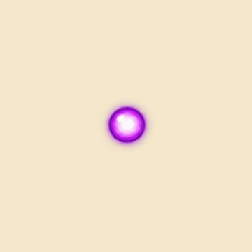

# Purple orb impact

Six frames at 20 fps, one 0.3-second burst. AlienShot spawns this visual prefab once on its first Food trigger and consumes the projectile as before. Duplicate callbacks cannot create multiple bursts. Offscreen expiry and unrelated contacts do not spawn the effect. The effect has only Transform, SpriteRenderer and Animator components; cleanup is scheduled with Destroy(effect, 0.3f), using scaled Unity time. No new physics or damage behavior is attached to the effect.

The Beam prefab adds only the impactPrefab reference; its original transform, renderer, collider, rigidbody and projectile fields are otherwise unchanged. See [shooting notes](../PantryProwlerShoot/README.md) for the antenna wind-up and release sequence. validation.json includes the joint 29-assertion stub test result and static asset checks. Unity import and gameplay playtest remain pending following the earlier Package Manager startup crash.

Built-in imagegen created the transparent six-cell VFX sheet from the extracted purple orb reference. Source and prompt are included. Sharp sliced fixed 256 × 256 cells with 16-pixel transparent gutters, preserving effect growth between frames. Atlas: 768 × 512, 256 PPU; prefab scale 0.9; no looping. impact.gif is a generated-art preview with a 0.7-second empty hold between bursts.
