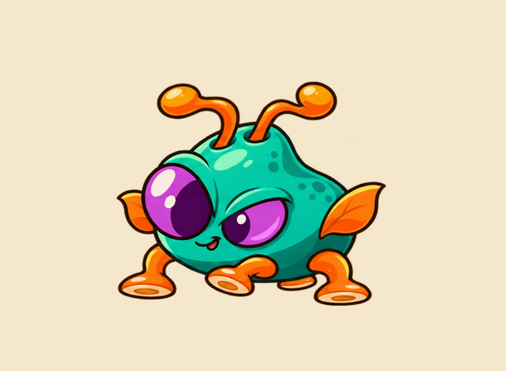

# Pantry Prowler antenna charge and throw

Six new shooting poses: antennae curl inward, a purple spark grows into an orb, both antennae flick forward, and the orb launches left. The detached orb was extracted from the generated artwork and reused as the live projectile.

## Timing and behavior

The attack runs at 8 fps for 0.75 seconds. Shooter locks movement and repeated attack triggers during the charge. The projectile and laser sound release once at 0.625 seconds, at the start of the follow-through pose. A 0.125-second recovery follows, then the existing reloadtime cooldown. This deliberately adds 0.75 seconds of attack animation to the previous immediate-shot behavior; the current prefab's 0.05-second reload gives a minimum cycle of about 0.8 seconds. Balance and responsiveness need a gameplay check.

Pancaking the enemy during charge cancels the projectile and returns the art to idle. Disabling the Shooter cancels its coroutine; disabling and re-enabling the animation cannot resurrect a canceled charge. A Shooter without this animation component keeps its immediate-fire behavior. Missing laser audio objects do not break the attack.

The projectile starts at the detached orb's horizontal position, on the existing lane Y, and retains the existing Beam prefab speed and physics. The orb is matched visually to the throw pose. The Shooter prefab, colliders, rigidbodies, damage tint and existing walk/idle assets are unchanged from the walking-animation commit. The Beam prefab adds a visual impact reference; see [impact notes](../PantryOrbImpact/README.md). Projectile canvas, GUID, import settings and PPU are preserved.

## Unity assets

- PantryProwlerShoot.png: 2700 × 1320 transparent atlas; 3 columns × 2 rows; six 900 × 660 cells with 100 PPU and centered pivots.
- PantryProwlerShoot.anim: sprite-only, 0.75 seconds, non-looping; six poses and a held final key.
- PantryProwler.controller: Idle, Walk, Shoot states. The Shooting boolean enters Shoot from any state without self-retriggering; clearing it returns immediately to Idle, then Walk when movement resumes.
- Shooter.cs and PantryProwlerAnimation.cs coordinate scaled-time wind-up, release, recovery and cancellation. No animation events are required.
- Purple orb.png uses the extracted matching orb in the existing 947 × 843 canvas.

The downloadable unity-patch includes both walking and shooting setup. Apply over the full art refresh (PR #2), preserving .meta files, or checkout the art/pantry-prowler-shoot-impact follow-up branch. There is no project/package upgrade.

## Validation and limits

Static checks passed for sprite/clip references, slice ordering and exact atlas/frame pixels, fixed planted baseline, no tint or transform animation, native controller transitions, and unchanged prefab/physics/walk/import settings. All three changed C# sources compiled against installed Unity 2022.3.62f3 assemblies using minimal GameData and audio contracts. The tests in Tests exercise Shooter, PantryProwlerAnimation and AlienShot sources against lightweight Unity API stubs: 29 assertions including impact handling cover release timing, sound timing, duplicate triggers, interruption, disable/re-enable, legacy firing and repeat attacks. These tests are not an engine simulation or a full game compilation.

Unity import and gameplay playtest remain pending. A prior batch attempt aborted starting Package Manager before asset import. In Unity 2022.3.43f1, verify charge-to-orb continuity, sound/release timing, repeated attacks, pause mid-charge, pancakes during charge, damage tint, lane collisions and the slower firing cadence. ArtRefresh/PantryProwlerWalk/verify-editor.cs includes an additional unrun Editor asset check.

## Generation and preview

Built-in imagegen created the six-pose sheet using the supplied original character reference. generated-master.png and prompt.txt preserve that source. Sharp registered torso size and foot baseline, sliced the sheet and extracted/repositioned the detached orb onto the lane center. PNG assets retain alpha. shoot.gif is an artwork/timing preview assembled from the delivered frames and projectile, not a Unity capture; it includes walk and idle context, with GIF's 10 ms timing rounding and a longer idle hold. manifest.json records emission position, frame registration and timing.
