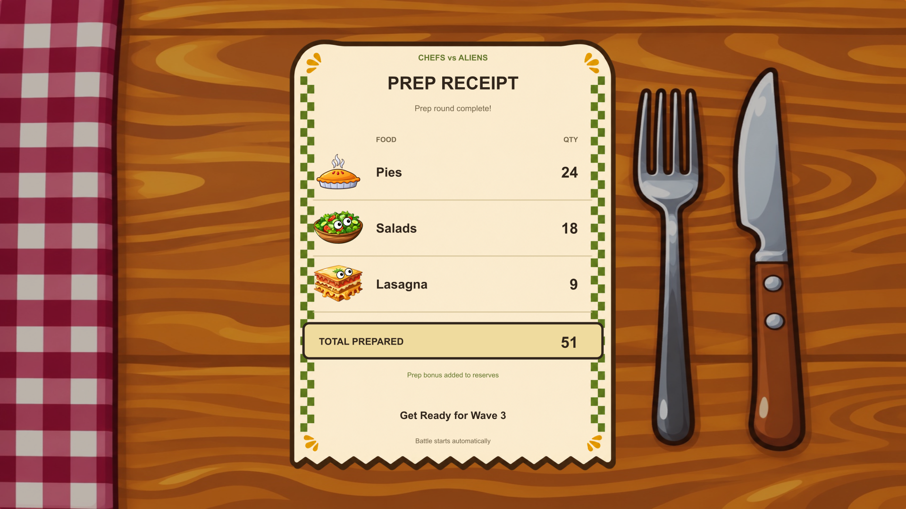

# Prep results receipt refresh

EndPrepTime now uses a warm cream receipt with olive checker trim, cartoon food icons, a matching wooden tabletop, clear quantity rows, a highlighted prepared-food total and the upcoming wave. All labels and results are native TextMesh Pro UI, not baked into the image.

The original EarnedMonsters component and its five live text bindings remain unchanged. Its totalText displays the sum of food prepared before the existing +100 reserve bonus. The old label incorrectly said after bonus; the new label is TOTAL PREPARED, with a separate note that the prep bonus is added to reserves. The reserve calculation itself is unchanged.

The original prepControls script still starts battle automatically after six seconds. No Continue button, input behavior, script or gameplay calculation was added or changed.

## Install

Use this PR branch, or copy unity-patch/Assets over current main after the earlier art/animation PRs. Preserve all .meta files. The patch includes the new receipt sprite, modified EndPrepTime scene and the existing image dependencies it reuses. The old invoice image remains in the repository but is no longer referenced by this scene. No Unity version or package changes are included.

## Layout and validation

The paper uses a fixed 1536 × 1920 RectTransform centered within the existing 3840 × 2160, height-matched CanvasScaler. Its children anchor to the paper, keeping the receipt's proportions intact at desktop 16:9, 16:10 and 4:3 aspect ratios. Quantities and wave text auto-size and stay on one line.

Static checks passed: all original object IDs and five result bindings are preserved; gameplay/bonus/transition scripts and nonvisual scene components are unchanged; hierarchy references are reciprocal; sprite GUIDs resolve without duplicates; all receipt content has nonzero area within the paper; and paper/background decorations do not intercept input. Geometry checks and reconstructed layouts cover 16:9, 16:10 and 4:3. No estimated text-fit warnings were found.

The previews reconstruct the actual scene data with approximate font rendering and illustrative values (24 pies, 18 salads, 9 lasagna, total 51, wave 3). Those sample results are not written into the scene or PlayerPrefs. Serialized numeric placeholders are zero and the existing Start method fills them at runtime. These are not Unity screenshots.

Unity import and gameplay verification remain pending: the earlier batch attempt aborted in Package Manager startup before import. In Unity 2022.3.43f1, finish a prep round, confirm the displayed quantities and total, verify the existing reserve bonus is applied once, resize the Game view, and confirm the six-second automatic battle transition.

## Artwork provenance

Built-in imagegen created the receipt panel in the established cartoon style, followed by a refinement to make the paper interior opaque and clean. prompt.txt contains both prompts, generated-master.png contains the selected final source, and receipt-paper.png is the 1120 × 1400 Unity sprite. The food characters, theme card and tabletop reuse existing project assets. validation.json and manifest.json record scope and checks.
