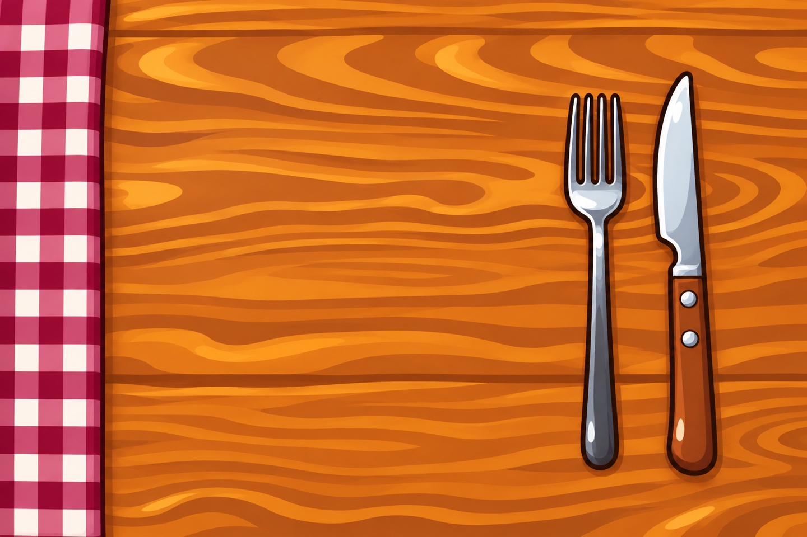
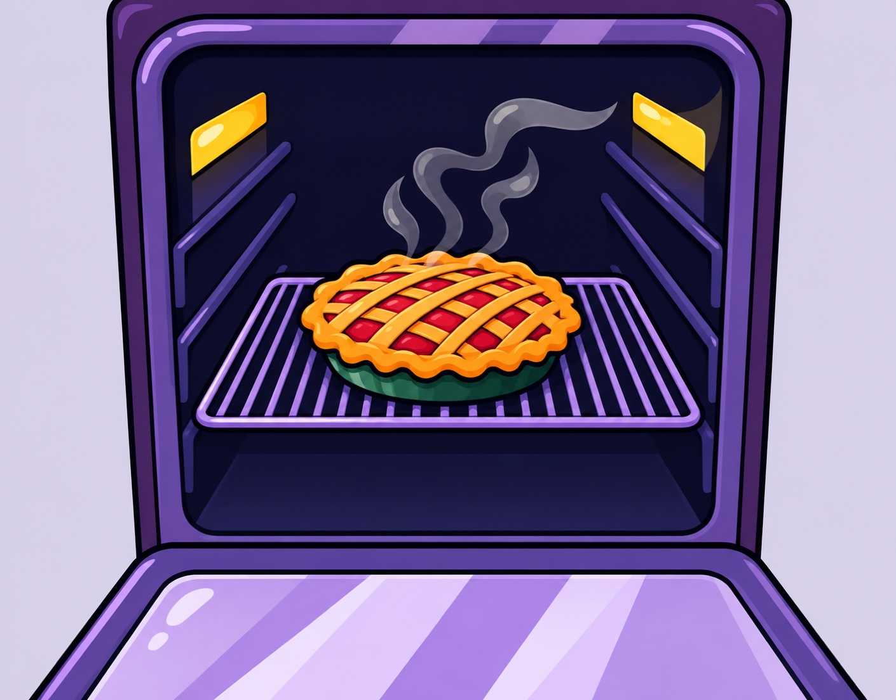
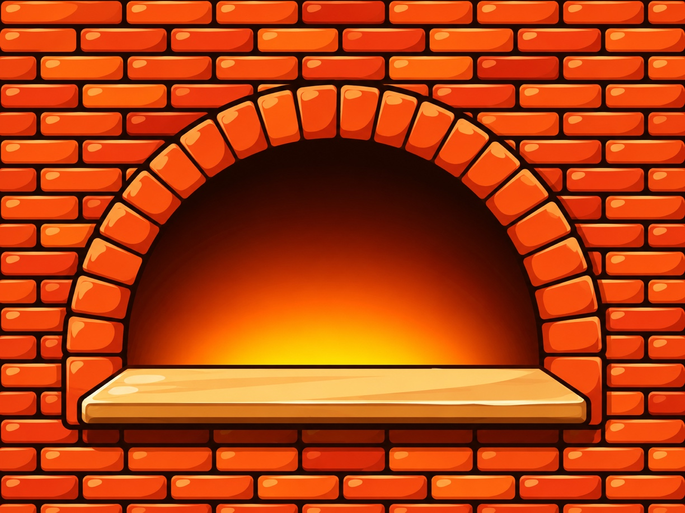
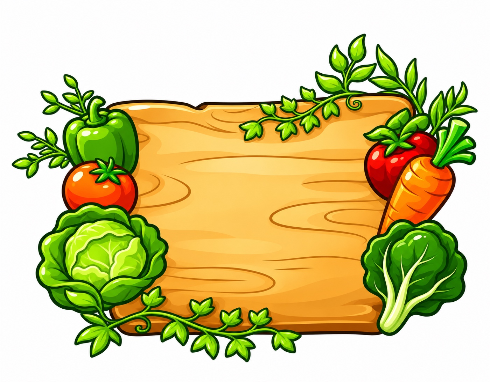
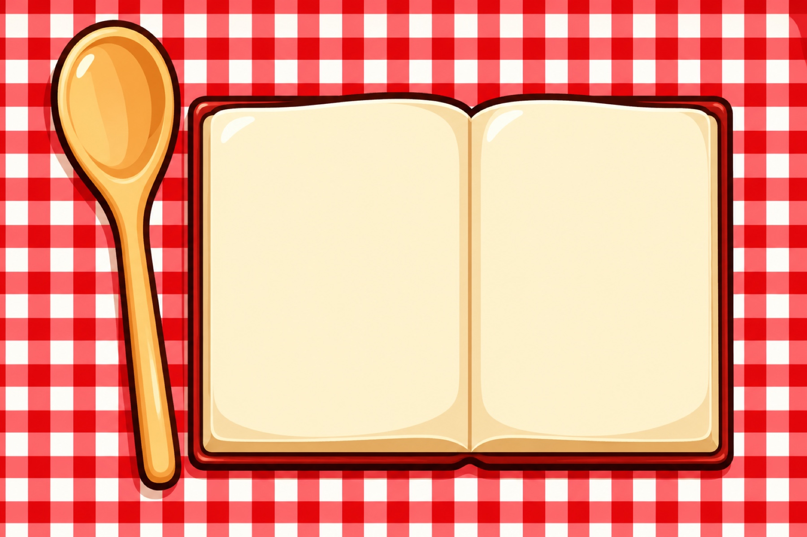

# Salad style artwork preview

Reference: the existing salad character. Final installed artwork is shown below; original versions are available through GitHub file history.

## tabletop

480 × 320 → 1440 × 960 pixels.

## lasagna

412 × 278 → 1648 × 1112 pixels.

## pie oven

470 × 368 → 1410 × 1104 pixels.

## brick oven

612 × 459 → 1224 × 918 pixels.

## kitchen

518 × 511 → 1036 × 1022 pixels.

## veggie board

700 × 547 → 1400 × 1094 pixels.

## lasagna example

156 × 185 → 1092 × 1295 pixels.

## cookbook

600 × 400 → 1800 × 1200 pixels.

## pie

612 × 585 → 1224 × 1170 pixels.

