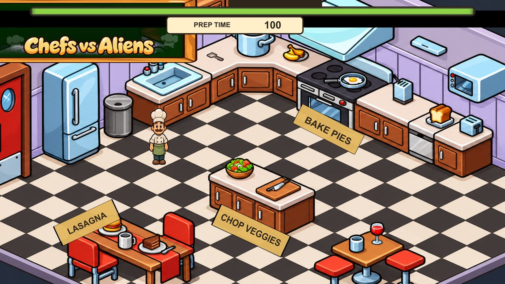
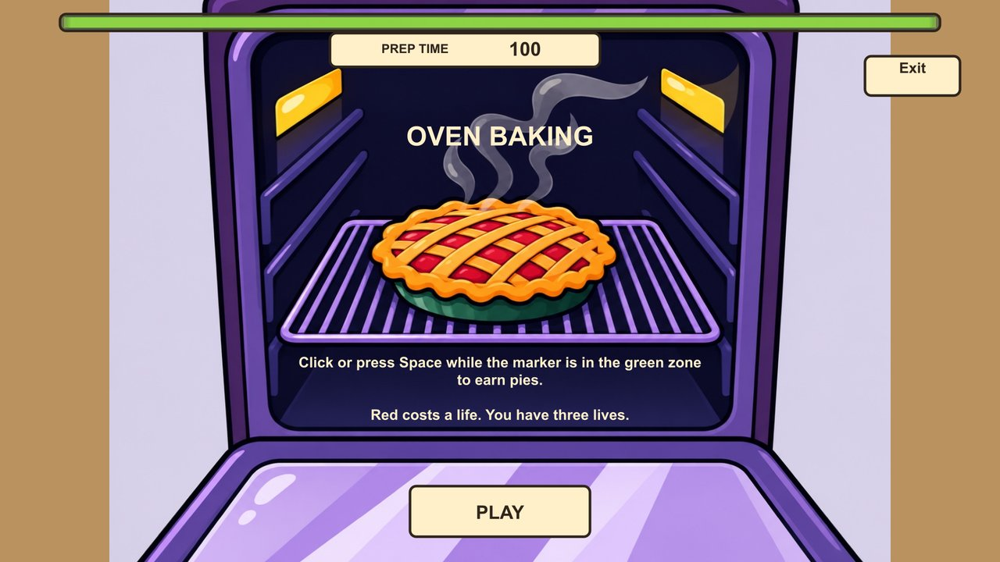
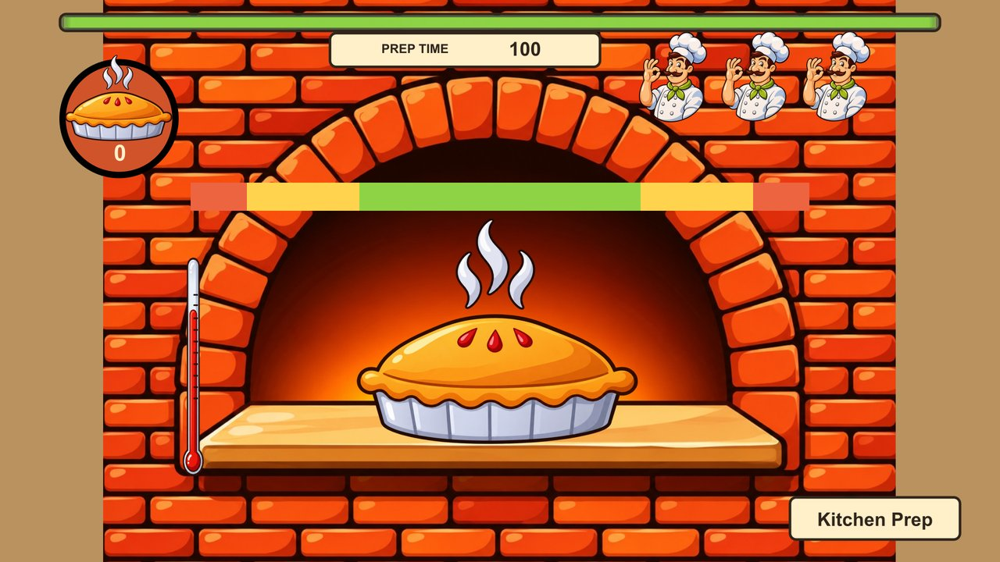
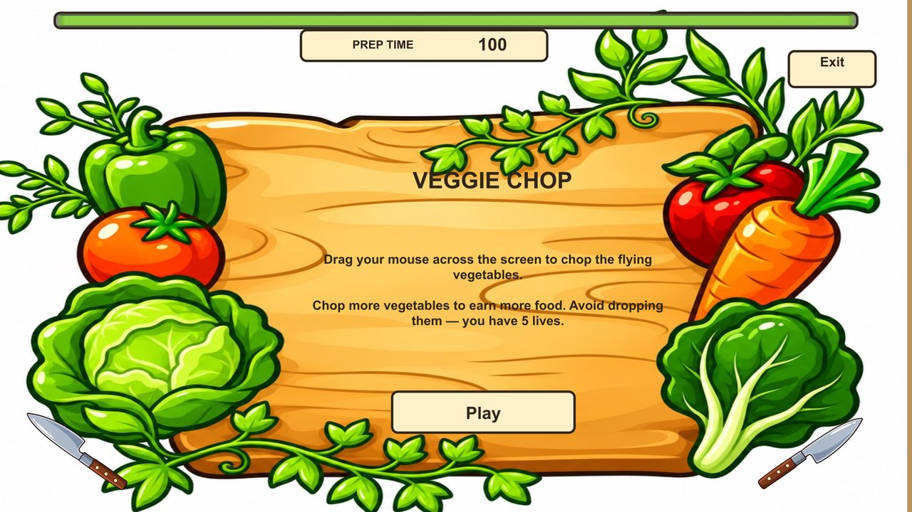
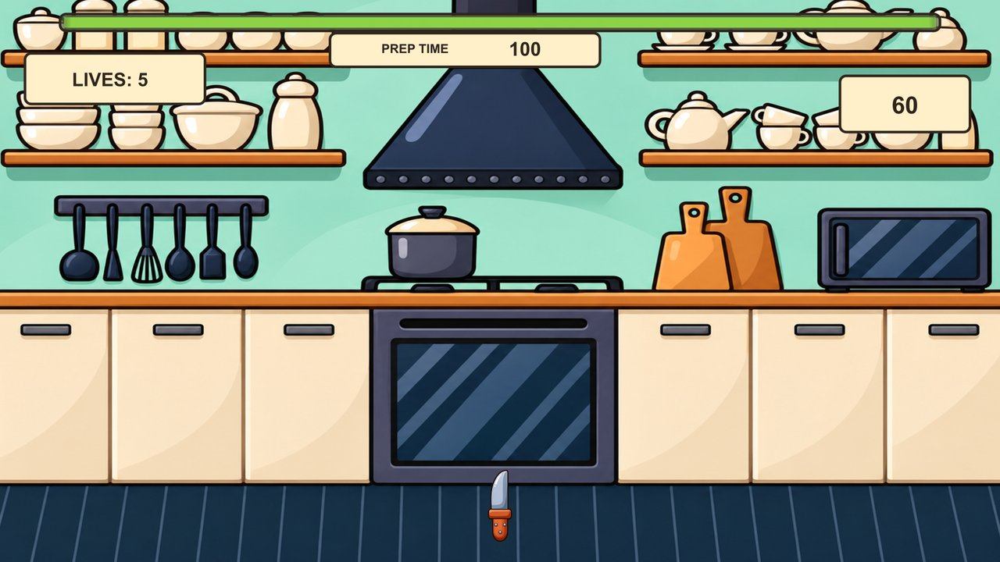
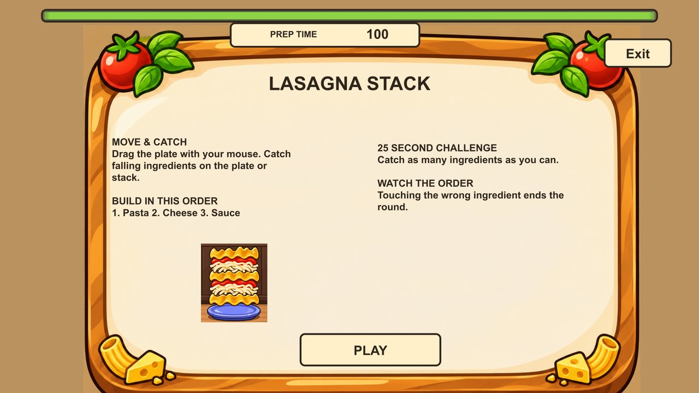
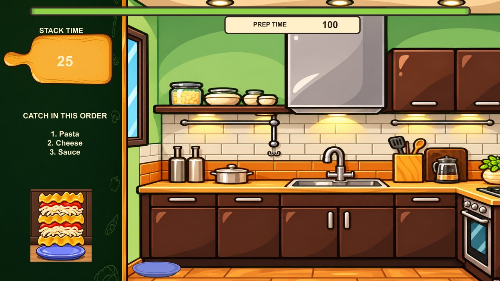
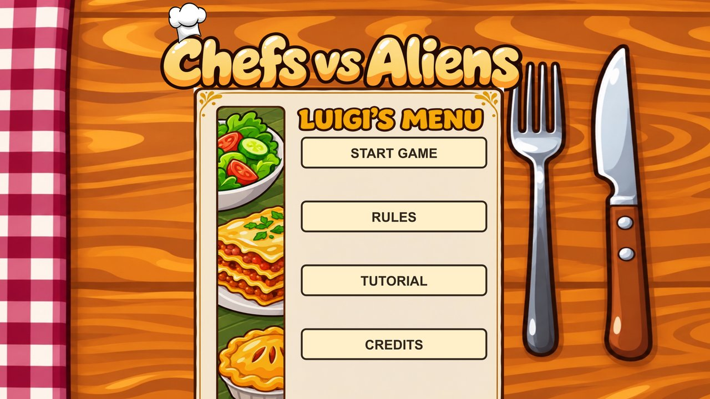
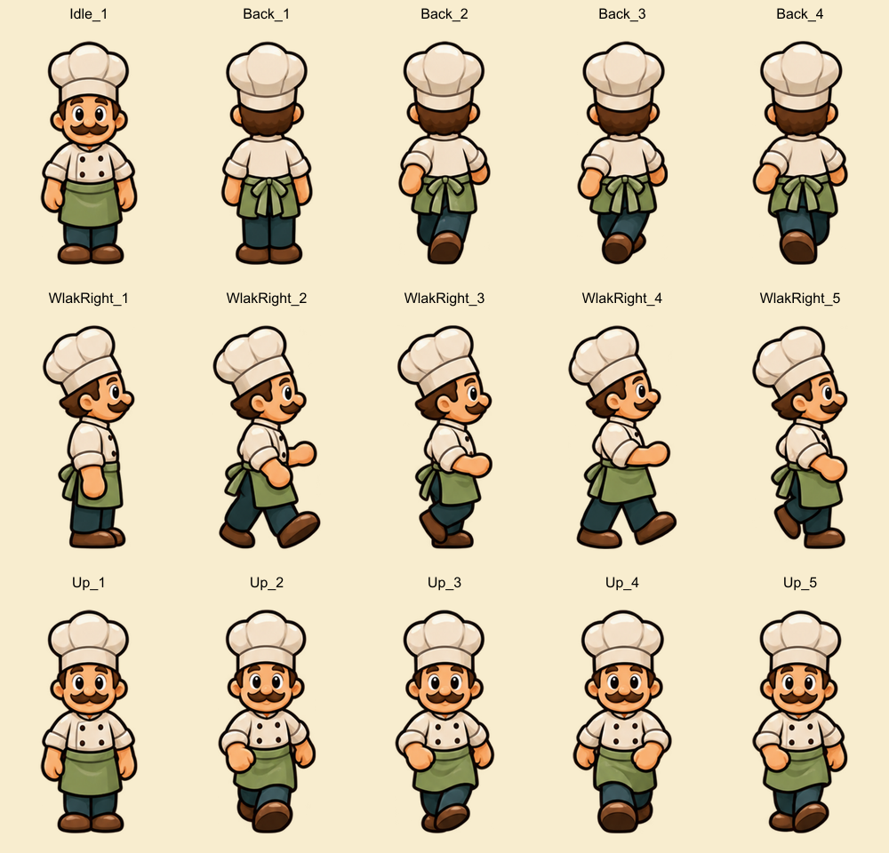

# Unified artwork preview

40 generated replacement assets and eight updated scenes. These are static layout reconstructions from scene data; Unity play-testing is pending.

## KitchenPrep

## OvenStart

## OvenMinigame

## VeggieStart

## SaladGame

## LasagnaStartGame

## LasagnaMiniGame

## MainMenu

## Pantry Prowler

Original replacement for Alien3.

## Chef frames

15 poses mapped to the original animation references; all 55 slice identities are retained.

