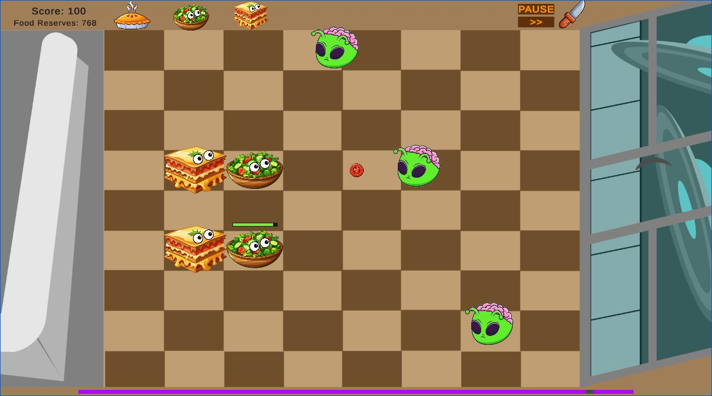
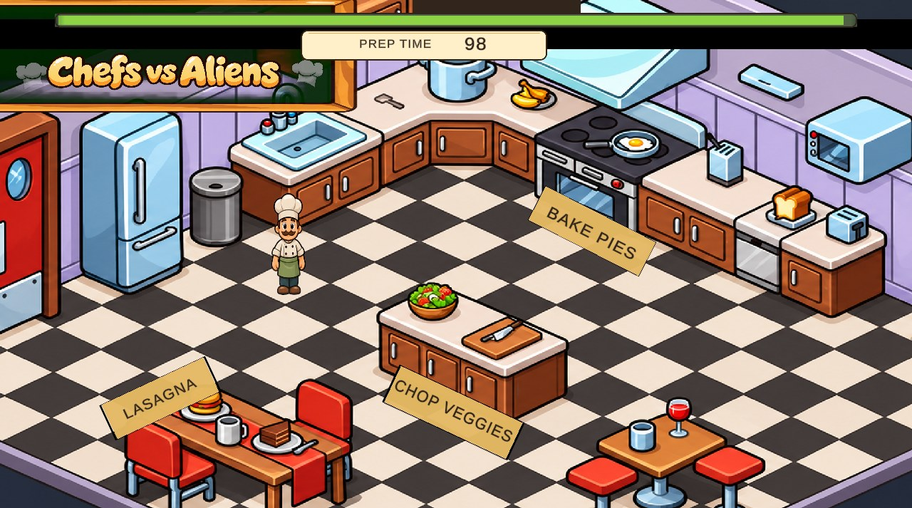
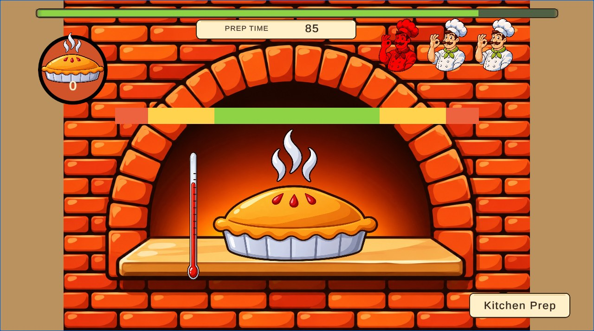

# CVA: Chefs vs Aliens

The greatest game of all time.

Chefs vs Aliens is a 2D Unity game where you cook food in kitchen minigames, then use it to defend your kitchen from waves of hungry aliens.



## Play it

| Checkpoint | Link |
|---|---|
| Sprint 1 | [pbland.itch.io/cva](https://pbland.itch.io/cva) |
| Sprint 2 | [lcarter343.itch.io/cva](https://lcarter343.itch.io/cva) |
| Final Game | [wwelden.itch.io/cva31](https://wwelden.itch.io/cva31) |
| CVA Remastered | [cva-psi.vercel.app](https://cva-psi.vercel.app) |

## Gameplay screenshots

| Kitchen Prep | Oven minigame |
|---|---|
|  |  |

## How the game works

1. **Kitchen Prep.** Walk the chef around the kitchen and step up to a cooking station to start its minigame:
   - **Lasagna**: move the plate to catch the falling pasta, sauce and cheese in the right order.
   - **Chop Veggies**: slice the flying vegetables for a salad without losing all your lives.
   - **Oven**: stop the moving bar in the right heat zone to bake a pie.
2. **Battlegrounds.** Spend the food you cooked to place defenders on the kitchen grid. Each food fights the aliens differently.
3. **Waves.** Aliens (including the Pantry Prowler, Brutes and Shooters) attack in waves. New foods unlock as you go: pancakes from wave 3, ice cream from wave 4 and salsa from wave 5. Between waves, you return to the kitchen to cook more.

## Controls

| Where | Input | Action |
|---|---|---|
| Kitchen Prep / Lasagna | WASD or arrow keys | Move |
| Oven | Space or left click | Stop the heat bar |
| Battlegrounds | 1–6 | Select food (4–6 unlock in later waves) |
| Battlegrounds | Left click or Space | Place the selected food |
| Battlegrounds | P | Pause |
| Battlegrounds | F | Toggle fast-forward |
| Battlegrounds | R | Toggle fork mode |
| Menus / minigames | Esc | Back / exit |

Debug shortcuts on the wave screen: **L** skips kitchen prep, **G** adds 1000 food.

## Running the project

1. Install Unity **6000.6.8f1** (see `ProjectSettings/ProjectVersion.txt`) through Unity Hub.
2. Clone the repo and open the folder in Unity Hub.
3. Open `Assets/Scenes/MainMenu.unity` and press Play.

To build, use **File → Build Profiles**. The scene list is already set in the build settings, with `MainMenu` first. The itch.io releases are WebGL builds.

## Project layout

```
Assets/
  Scenes/
    MainMenu, GameSelector, KitchenPrep, EndPrepTime, GameOver
    LasagnaStartGame, LasagnaMiniGame     # lasagna minigame
    VeggieStart, SaladGame                # veggie chopping minigame
    OvenStart, OvenMinigame               # oven / pie minigame
    BattleGrounds/                        # Kitchen (tower defense) and WaveScreen
    CutScene/                             # story cutscenes and wave transitions
    Tutorials/                            # Battlegrounds and food tutorials
  Scripts/
    BattleGrounds/                        # GameManager, GameData, EnemySpawner, Player
      Aliens/                             # Enemy, Brute, Shooter, Pantry Prowler animation
      Food/                               # Pie, Salad, Lasagna, Pancakes, IceCream, Salsa
    Lasanga/                              # kitchen prep movement and lasagna minigame
    SaladGame/                            # veggie chopping minigame
    Oven/                                 # oven minigame
    CutScene/                             # cutscene controllers
  Sprites/, Audio/, Prefabs/, Resources/
ArtRefresh/                               # notes, previews and validation for the art refresh
```

## Art refresh

The game's artwork was redrawn in a single cartoon style, with an original Pantry Prowler alien and new result screens. See [ArtRefresh/README.md](ArtRefresh/README.md) for what changed, previews and validation notes.

## Team

Built by William Welden, Laila Carter, Paul Bland and Jorge Larach.
